# Architecture & Maintenance Guide — Shree Balaji Enterprises

This document provides technical reference for maintaining, updating, and deploying the Shree Balaji Enterprises web application.

---

## 1. System Architecture

The application is structured into four primary layers:

```mermaid
graph TD
  Client[Browser Client] --> Router[Next.js App Router]
  Router --> StaticPages[Static Pages / SSG]
  Router --> DynamicRoutes[Dynamic Routes: /buy/:id, /rent/:id]
  Router --> AdminPortal[Admin Dashboard: /admin]
  Router --> API[API Route: /api/imagekit/upload]
  StaticPages --> CoreMotion[Motion Primitives: InView, AnimatedGroup]
  StaticPages --> StaticData[lib/data.ts: Properties & Agents]
  AdminPortal --> LocalStore[lib/admin-store.ts: LocalStorage Inquiries]
  API --> ImageKit[ImageKit CDN API]
```



### Static Generation & Performance
- **33 Routes Total**: 30 statically prerendered routes (`○`), 2 SSG routes (`●`), and dynamic server routes (`ƒ`).
- **Turbopack Build**: Configured with Next.js 16 compiler optimization for fast page loads and small bundle sizes.
- **Images**: Served through Next.js Image Optimization from `public/images/`.

---

## 2. Maintenance Workflows

### How to Add or Update a Property Listing
Property listings are maintained in [`lib/data.ts`](file:///c:/Programming/Personal%20Coding/Projects/final/SBE/lib/data.ts):
1. Locate `export const properties: PropertyData[] = [...]`.
2. Append or edit the property object following the `PropertyData` interface:
   ```ts
   {
     id: 101,
     title: "Sai Paradise 2 BHK Luxury Flat",
     type: "buy", // "buy" | "rent"
     category: "Residential", // "Residential" | "Commercial" | "Industrial" | "Plots"
     price: 4500000,
     priceDisplay: "₹45 Lakhs",
     location: "Ambernath-East",
     city: "Ambernath",
     bhk: 2,
     bathrooms: 2,
     area: 680,
     image: "/images/house1.jpg",
     gallery: ["/images/house1.jpg", "/images/interior1.jpg"],
     featured: true,
     verified: true,
     reraId: "P51700012345",
     // ...
   }
   ```
3. Run `npm run build` to verify that `getStaticPaths` / `generateStaticParams` generates the new property pages.

### How to Update Agent Profiles
Agent profiles are defined in `export const agents: AgentData[] = [...]` in [`lib/data.ts`](file:///c:/Programming/Personal%20Coding/Projects/final/SBE/lib/data.ts).
- Always use `/images/logo.png` or uploaded photo paths in `image`.
- Ensure phone numbers match the business contact lines.

### Managing Inquiries
1. Inquiries submitted via `/contact`, `/sell`, or `/sign-in` are logged into client-side storage via [`lib/admin-store.ts`](file:///c:/Programming/Personal%20Coding/Projects/final/SBE/lib/admin-store.ts).
2. Access the Admin portal at `/admin/login` using the administrative pin.
3. Inquiries can be filtered by category, marked as "In Progress", or "Closed".

---

## 3. Deployment & Domain Configuration

- **Hosting**: Deployed on Vercel.
- **Production Domain**: `https://www.shreebalajienterprises.live`
- **Metadata Base**: Configured in [`app/layout.tsx`](file:///c:/Programming/Personal%20Coding/Projects/final/SBE/app/layout.tsx) with Canonical URLs, OpenGraph previews, and Twitter cards.
- **Sitemap & Robots**: Dynamically generated via [`app/sitemap.ts`](file:///c:/Programming/Personal%20Coding/Projects/final/SBE/app/sitemap.ts) and [`app/robots.ts`](file:///c:/Programming/Personal%20Coding/Projects/final/SBE/app/robots.ts).
